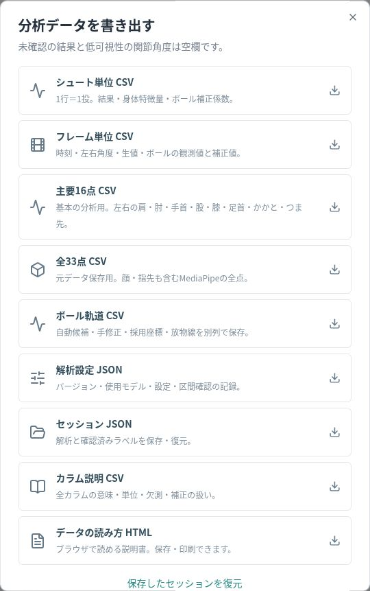

# v0.2への更新 — GitHubの画面だけで行う場合

このファイルを受け取っただけでは、今公開中のサイトは変わりません。既存の `ponapona/shotlab-free-throw` を更新します。新しいリポジトリは作りません。

1. 更新版ZIPをダウンロードし、右クリック→「すべて展開」。ZIP内の `shotlab-github` フォルダーを開きます。
2. [リポジトリのCode画面](https://github.com/ponapona/shotlab-free-throw)を開きます。
3. ファイル一覧上部の **Add file → Upload files** を押します。
4. エクスプローラーで `shotlab-github` の**中身**（`src`、`public`、`scripts`、`config`、`components`、`analysis`、`tests`、`docs`などのフォルダーと、README・package.jsonなどのファイル）を選び、GitHubのアップロード欄へドラッグします。ZIPそのものや、一番外側の `shotlab-github` フォルダーはアップロードしません。同じパスのファイルが更新されます。
5. 下の入力欄に `Add ball tracking and separate pose exports` と書き、**Commit changes** を押します。既存の `.github/workflows/pages.yml` はそのまま使います。隠しフォルダーをもう一度作る必要はありません。
6. [Actions](https://github.com/ponapona/shotlab-free-throw/actions/workflows/pages.yml)を開き、左の **Publish GitHub Pages** → **Run workflow** → `main` → 緑の **Run workflow** を1回押します。これはサイトの更新処理です。利用者が動画解析するたびに押すものではありません。
7. 今回の実行が緑のチェックになったら、[公開アプリ](https://ponapona.github.io/shotlab-free-throw/)を開き直します。古い画面なら **Ctrl + F5**（Windows）で更新します。
8. 画面上部の **v0.2.0**、モーション欄の **主要16点／全33点** と別々のCSVボタンを確認します。5〜10秒の動画を読み込み、ボールの範囲・軌道・手修正も確認してください。

途中で赤い×になったら、失敗した実行を開き、赤い項目のエラー文を確認します。新しいリポジトリや別のワークフローを作り直す必要はありません。

保存済みのv0.1セッションは同じ動画と一緒に復元できます。ただし復元だけではボールの自動推論は走りません。自動検出を行う場合は動画を新しく解析してください。手動のボール点追加は復元後でも使えます。旧セッションも残しておいてください。

更新版の出力メニュー：

